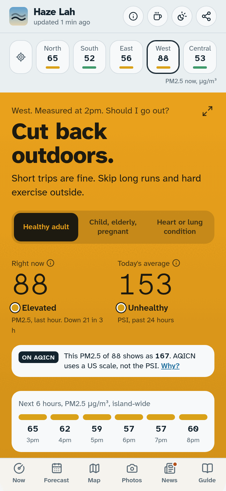
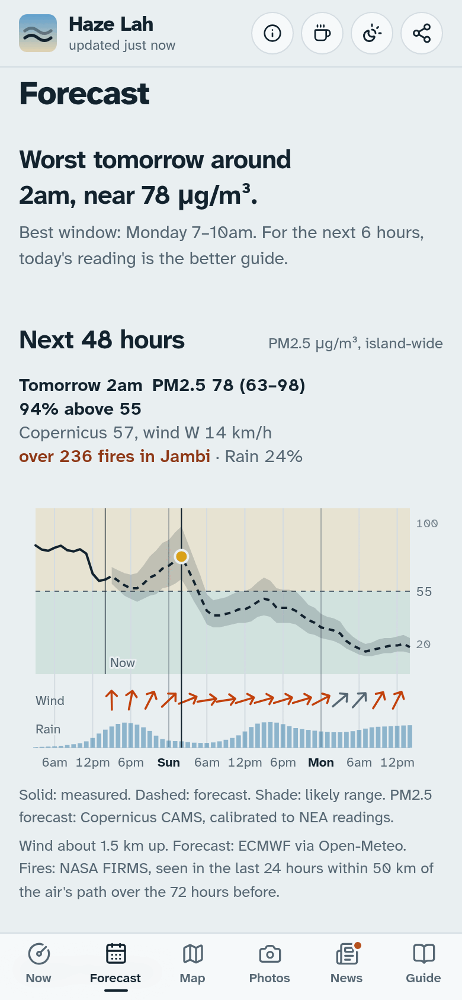
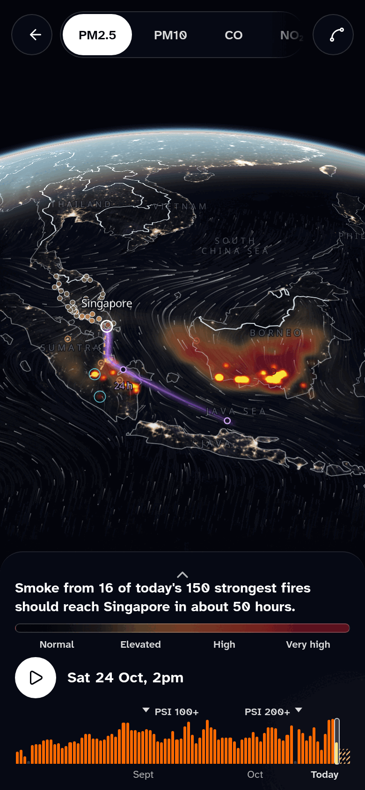
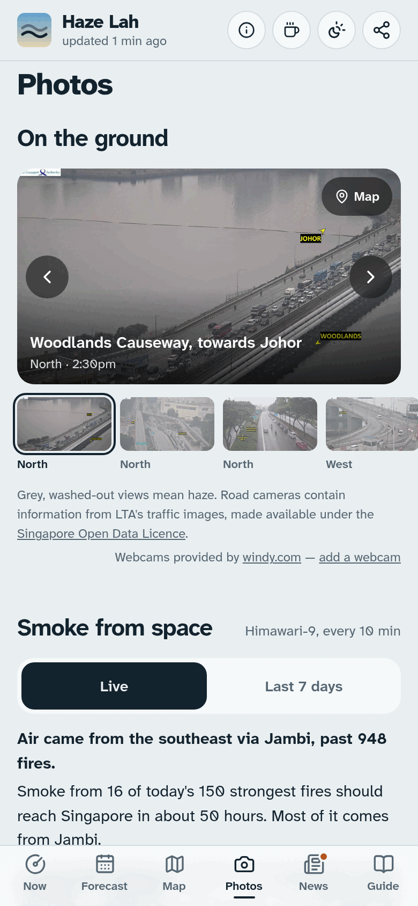

# Haze Lah

**Is it safe to go out?** A free, mobile-first haze tracker for Singapore. It turns official air-quality readings, satellite fire data and an atmospheric smoke model into one clear answer, a forecast you can plan around, and the science behind it.

[](LICENSE)
[](https://www.hazelah.app)
[](https://ko-fi.com/sr33r00)
[](https://nextjs.org)
[](#quick-start)

<table>
  <tr>
    <td align="center"><br>Now</td>
    <td align="center"><br>Forecast</td>
    <td align="center"><br>Air globe</td>
    <td align="center"><br>Photos</td>
  </tr>
</table>

Haze Lah is independent and is not an official NEA service. For official advisories, see [haze.gov.sg](https://www.haze.gov.sg).

## What it does

- **Now.** A plain answer ("Go ahead", "Short outings only", "Stay indoors") based on NEA's health advice for healthy adults, children, the elderly, pregnant women and people with heart or lung conditions. Live 1-hour PM2.5 and 24-hour PSI for all five regions, with "use my location". Practical steps for the current level (windows, purifiers, N95 masks, schools, when to see a doctor), a plan for the next 24 hours with the cleanest 3-hour window, today's air as cigarettes (Berkeley Earth's 22 µg/m³ per cigarette), and the pollutants behind the PSI.
- **Smoke map.** One zoomable map on Now: the PM2.5 forecast as a smoke veil, today's fires, wind, the path of today's air and the live readings, with a time slider from the past days to the next 72 hours. A PM2.5 / US AQI toggle switches the unit. A card traces where today's air came from.
- **Forecast.** One answer, then a 48-hour instrument you can scrub: PM2.5 with its likely range, plus wind and rain lanes. Below it, the next 5 days with the likely peak, the chance PM2.5 rises above 55 µg/m³ and the expected 24-hour PSI, and how accurate the forecast has been.
- **Photos.** Road cameras and webcams first, so you can see the haze where you are. Then smoke from space, with a Live / Last 7 days toggle: a Himawari-9 loop, or NASA smoke thickness for each of the last 7 days.
- **Air globe (`/map`).** A full-screen globe you can zoom and turn, with a timeline from 1 August to the forecast. Layers: PM2.5, PM10, carbon monoxide, nitrogen dioxide, sulphur dioxide, ozone and dust (Copernicus), and NASA satellite smoke. Over them: fires, wind, the path of the air, measured readings and modelled Indonesian cities.
- **News.** NEA haze updates, the official weather outlook and changes in the live readings, with a count of the days in the current haze spell.
- **Guide.** Sourced answers on masks, exercise, schools, work and health.
- **Alerts.** An optional Telegram channel posts when the 24-hour PSI band changes or NEA issues a haze update.
- **Measured accuracy.** Every forecast is saved when it is made and scored against what NEA later measured.

## Data sources

| Source | Used for | Licence or terms |
|---|---|---|
| [NEA via data.gov.sg](https://data.gov.sg) | Live PM2.5, PSI and pollutant sub-indices; hourly PSI since 2014 for the records | [Singapore Open Data Licence](https://data.gov.sg/open-data-licence) |
| [LTA traffic images via data.gov.sg](https://data.gov.sg) and [LTA DataMall](https://datamall.lta.gov.sg) | Road camera photos | Singapore Open Data Licence. The site shows "contains information from LTA's traffic images, made available under the Singapore Open Data Licence" |
| [Malaysia DOE APIMS](https://eqms.doe.gov.my/APIMS/main) | Malaysian Air Pollutant Index | Public data, attributed |
| [OpenAQ](https://openaq.org) | Community air sensors (mainly AirGradient monitors), hourly PM2.5 | Credited on the site. Each sensor's data stays under its provider's terms |
| [AQICN, World Air Quality Index Project](https://waqi.info) | Air quality stations in Singapore on the map's US AQI view | Official API with a free token. Credit required. Its terms forbid redistributing cached or archived data, so it is never saved to `data/` |
| [NASA FIRMS](https://firms.modaps.eosdis.nasa.gov) | Satellite fire detections (VIIRS) | NASA open data |
| [NASA GIBS](https://gibs.earthdata.nasa.gov) | Satellite pictures: smoke (OMPS aerosol index), smoke thickness (VIIRS Deep Blue aerosol optical depth) | NASA open data |
| [Himawari-9 (JMA)](https://www.data.jma.go.jp/mscweb/en/himawari89/) via NASA GIBS | The live "Smoke from space" loop | Credited as "Himawari-9 (JMA) via NASA GIBS" |
| [Windy webcams](https://www.windy.com/webcams) | Webcam photos around Singapore (free tier) | Windy's terms: images loaded from Windy and linked back to its page, with the credit "Webcams provided by windy.com" |
| [OpenFreeMap](https://openfreemap.org) with [MapLibre GL JS](https://maplibre.org) | The vector map under the satellite data: coasts, borders and place names. Zoomed out, a light outline of [Natural Earth](https://www.naturalearthdata.com) (public domain) stands in for its heavy world tiles | OpenFreeMap: free, no key. Map data © [OpenStreetMap contributors](https://www.openstreetmap.org/copyright) (ODbL), schema © [OpenMapTiles](https://openmaptiles.org) (CC BY 4.0). MapLibre: BSD-3-Clause |
| [Copernicus CAMS via Open-Meteo](https://open-meteo.com/en/docs/air-quality-api) | PM2.5 and gas forecasts, and the regional smoke map | CC BY 4.0, contains modified Copernicus information |
| [ECMWF via Open-Meteo](https://open-meteo.com) | Wind at 850 hPa and rain | CC BY 4.0 |
| [NEA haze updates](https://www.nea.gov.sg/media/news/advisories) and [Meteorological Service Singapore](https://www.weather.gov.sg/weather-forecast-24hrs/) | Haze announcements and the 24-hour weather outlook, from their feeds | Attributed |
| [CNA](https://www.channelnewsasia.com) and [The Straits Times](https://www.straitstimes.com) | Haze headlines, linked to the original story | Attributed |

Reference only: [ASEAN Specialised Meteorological Centre](https://asmc.asean.org) and [MyCMAQ](https://mycmaq.met.gov.my).

Every air reading the site shows (except AQICN's) is also saved to `data/readings/`, one file per Singapore day, so it outlives the live page. How the archive works, and what is saved from each source, is in [docs/data-pipelines.md](docs/data-pipelines.md). Per-source detail is in [docs/data-sources.md](docs/data-sources.md).

## How the forecast works

1. **Baseline model.** The Copernicus CAMS global forecast (0.4° grid, about 45 km, 3-hourly) gets the timing of smoke episodes broadly right but is often far off in magnitude for peat haze.
2. **Calibration.** It is rescaled to NEA's readings over the past 48 hours (median log-ratio bias), and the current error fades out over about 12 hours, so the first hours follow what is being measured now.
3. **Uncertainty.** The likely range comes from the recent spread of errors and widens with lead time. The same spread gives the chance of exceeding 55 µg/m³.
4. **PSI outlook.** The 24-hour PSI is computed from a rolling 24-hour mean of PM2.5 using NEA's sub-index breakpoints.

Advice follows NEA's guidance: 1-hour PM2.5 for what to do right now, and the 24-hour PSI for planning ahead.

**Verification.** A scheduled GitHub Actions job (`.github/workflows/archive.yml`) saves each forecast as issued to `data/archive/` and writes `data/accuracy.json`. Scores are reported at 6, 24, 48, 72 and 96 hours ahead against two baselines, the raw model and "no change": mean absolute error, RMSE and bias in µg/m³, precision and recall for PM2.5 above 55 µg/m³, and a hazy-day hit rate for forecasts made at 11 pm the night before. The archive is open, so anyone can reproduce the scores.

More in [docs/forecast.md](docs/forecast.md).

## Quick start

Requires Node.js 20 or newer.

```bash
npm install
HAZE_MOCK=1 npm run dev   # demo data, no network or keys needed
npm run dev               # live data
```

Open <http://localhost:3000>. Checks:

```bash
npm test            # node:test, through tsx
npx tsc --noEmit    # types
npm run lint        # ESLint
```

More in [docs/development.md](docs/development.md).

## Configuration

All variables are optional. Copy `.env.example` to `.env.local` to set them. Keys stay on the server and are never sent to the browser.

| Variable | Purpose |
|---|---|
| `FIRMS_MAP_KEY` | Free [NASA FIRMS key](https://firms.modaps.eosdis.nasa.gov/api/map_key/) for fire counts and the fire map |
| `DATA_GOV_SG_API_KEY` | data.gov.sg key for higher rate limits |
| `OPENAQ_API_KEY` | Free [OpenAQ key](https://explore.openaq.org/register) for community air sensors on the map |
| `WAQI_TOKEN` | Free [AQICN token](https://aqicn.org/data-platform/token/) for the US AQI stations on the map |
| `LTA_DATAMALL_KEY` | [LTA DataMall](https://datamall.lta.gov.sg) key: about 90 traffic cameras instead of 8 |
| `WINDY_WEBCAMS_KEY` | [Windy webcams](https://api.windy.com/keys) API key (free tier) for webcam photos |
| `HAZE_MOCK` | `1` renders synthetic demo data (offline development) |
| `NEXT_PUBLIC_ALERTS_URL` | Telegram channel link (`https://t.me/...`) for the "Get alerts" button |
| `TELEGRAM_BOT_TOKEN`, `TELEGRAM_CHAT_ID` | Bot and channel used by `scripts/alert.ts` to post alerts |
| `RESEND_API_KEY`, `FEEDBACK_EMAIL` | Free [Resend](https://resend.com) key and the address that receives the feedback form |
| `FEEDBACK_CHAT_ID` | Or your own Telegram chat id: the feedback form messages you through the same bot |
| `SITE_URL` | Site link in alert messages (default `https://hazelah.app`) |

## Public JSON API

No key needed. Use it kindly: responses are cached, so there is no point in polling faster than every few minutes.

| Endpoint | Returns |
|---|---|
| `/api/haze` | Everything the Now page uses: NEA readings, stations, sensors, fires, news, PSI history and the forecast. Sent with `Access-Control-Allow-Origin: *`; cached for 30 minutes |
| `/api/smoke` | The regional smoke grid: PM2.5, six other pollutants and the wind, as numbers per time step. No CORS header |
| `/api/replay` | The last days of fires and the path of the air, plus the wind outlook. No CORS header |

## Project structure

```text
src/app/          pages and API routes
src/components/   page sections
src/lib/          data assembly, forecast, bands and advice
src/lib/sources/  one module per data provider
scripts/          archive, scoring, alert, history and readings jobs
data/             open archives: forecasts, readings, history, accuracy
.github/          issue forms and scheduled jobs
```

How the parts fit together is in [docs/architecture.md](docs/architecture.md).

## Documentation

- [docs/README.md](docs/README.md): index
- [docs/architecture.md](docs/architecture.md): how the app is put together
- [docs/data-sources.md](docs/data-sources.md): each provider, what is used and how
- [docs/forecast.md](docs/forecast.md): the forecast method in full
- [docs/data-pipelines.md](docs/data-pipelines.md): the scheduled jobs and the open data archives
- [docs/development.md](docs/development.md): working on the code
- [docs/decisions/](docs/decisions/): why things are the way they are

## Contributing

Issues and pull requests are welcome. Please read [CONTRIBUTING.md](CONTRIBUTING.md) first. It covers the checks to run, the code style and the rule that every health or science claim cites a source. Please follow the [Code of Conduct](CODE_OF_CONDUCT.md). Report security issues as described in [SECURITY.md](SECURITY.md), and see the [changelog](CHANGELOG.md) for what changed in each version.

## Support

Haze Lah is free, has no ads and is run by one person. Donations pay for running costs and new features: [ko-fi.com/sr33r00](https://ko-fi.com/sr33r00). Thank you.

## Licence

[GNU AGPL v3](LICENSE) with an attribution term ([NOTICE](NOTICE)): you may use, change and share Haze Lah, including running it as a website, if you publish your source under the same licence and keep a visible credit "Based on Haze Lah by Sr33". Data shown by the program remains under the licences of its providers listed above.

## Disclaimer

Haze Lah is an independent project. It is not an official NEA or government service and gives general information, not medical advice. For official advisories, see [haze.gov.sg](https://www.haze.gov.sg).
