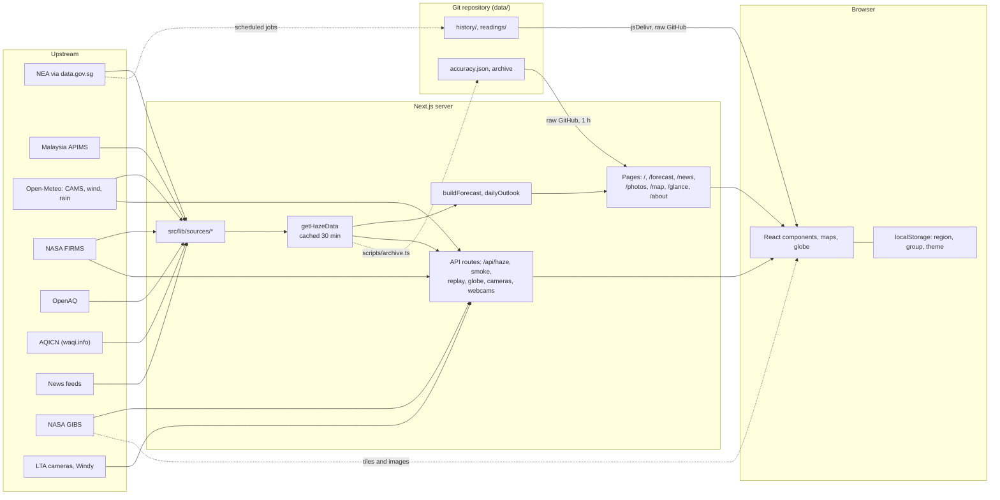

# Architecture

Haze Lah is a Next.js 15 App Router site. One server-side function, `getHazeData` in `src/lib/data.ts`, gathers the data from every upstream source, applies the forecast, and hands the result to the pages. The browser then draws it. Anything personal (location, region, health group) stays in the browser.

Related pages: [data sources](data-sources.md), [forecast](forecast.md), [data pipelines](data-pipelines.md), [development](development.md), [decisions](decisions/README.md).

## Data flow

Solid lines are the live path. Dotted lines are the scheduled jobs and the browser loading pictures straight from NASA. The jobs are described in [data pipelines](data-pipelines.md).

## Request flow

1. A visitor opens a page such as `/`. The page is a React Server Component with `export const revalidate = 1800`, so Next.js serves a stored copy and rebuilds it in the background at most every 30 minutes.
2. When a rebuild happens, the page calls `getHazeData()`.
3. `getHazeData()` returns `cachedHazeData()`, a `unstable_cache` wrapper (key `haze-data`, `revalidate: 1800`) around `buildHazeData(false)`.
4. `buildHazeData` calls `fetchInputs()`, which starts 11 fetchers from `src/lib/sources/` at once with `Promise.allSettled`. Each one that fails is logged on the server and its name is added to `errors`.
5. If NEA history exists, `buildForecast` (`src/lib/forecast.ts`) calibrates the CAMS forecast and `dailyOutlook` makes the 5-day outlook. See [forecast](forecast.md).
6. The result is a `HazeData` object (`src/lib/types.ts`): readings, stations, fires, news, forecast, `errors` and `generatedAt`.
7. The page passes slices of it to client components as props. The browser never calls the upstream APIs for this data.

`HAZE_MOCK=1` skips all of this and builds synthetic data from `src/lib/mock.ts`. Mock data is never cached.

## Pages

| Route | File | Renders |
|---|---|---|
| `/` | `src/app/page.tsx` | The Now tab (`NowView`): region chips, the hero answer, "is it getting better" (`HazeOutlook`), "Plan your day" (`PlanDay`), "What to do" (`Advice`), the cigarette comparison, "Across Singapore" (`SgMap`), live camera photos (`LiveViews`), "What is in the air" (`AirDetail`) and "where the air came from" (`HazeOrigin`). The footer lists any sources that failed. |
| `/forecast` | `src/app/forecast/page.tsx` | `ForecastView`: the plain answer, the 48-hour instrument, the 5-day outlook, forecast accuracy (`fetchAccuracy`) and the past week of PSI. |
| `/news` | `src/app/news/page.tsx` | `NewsView`: NEA, MSS, CNA and Straits Times items and a timeline of changes (`buildTimeline` in `src/lib/situation.ts`), plus the current haze spell (`currentStreak`). |
| `/photos` | `src/app/photos/page.tsx` | `GroundViews` (LTA cameras and Windy webcams) and `FromSpace` (the region from space: a live Himawari loop and daily smoke thickness). |
| `/map` | `src/app/map/page.tsx` | `MapScreen`: the full-screen MapLibre globe with a timeline from 1 August to the forecast. Also builds a text summary for screen readers and crawlers. |
| `/about` | `src/app/about/page.tsx` | Sources, how the advice and forecast work, accuracy table, privacy, release notes. |
| `/guide` | `src/app/guide/page.tsx` | `GuideView`: short answers on masks, exercise, schools and health from `src/lib/guide.ts`, with FAQ structured data. Fully static: it shows no live readings, so it gets no data. |
| `/glance` | `src/app/glance/page.tsx` | `GlanceView`: one big number and verdict for a home-screen shortcut or wall display. Marked `noindex`. |

All pages except `/guide` share `AppShell` (`src/components/AppShell.tsx`): header, navigation, theme toggle and the "updated N min ago" label. `/map` and `/glance` draw their own full-screen layout.

## Other routes

These sit beside the pages in `src/app/`. Caching values are copied from each file.

| Route | File | Purpose | Caching |
|---|---|---|---|
| `/api/haze` | `api/haze/route.ts` | The whole `HazeData` as JSON, open to any origin (`Access-Control-Allow-Origin: *`), with `aqiStations` empty (AQICN's terms). The alert job reads it. | `revalidate = 1800`; `s-maxage=1800, stale-while-revalidate=600` |
| `/api/smoke` | `api/smoke/route.ts` | Regional CAMS grid (PM2.5 and gases) and wind, 1° steps, every 3 h for 72 h. | `force-dynamic`; `max-age=300, s-maxage=3600, stale-while-revalidate=10800`. Upstream requests are kept 3 h in the fetch cache. |
| `/api/replay` | `api/replay/route.ts` | Back-trail of the air, fires, wind outlook, "smoke on the way" (`getReplay` in `src/lib/replayData.ts`). | `force-dynamic`; `max-age=300, s-maxage=1800, stale-while-revalidate=3600` |
| `/api/globe/[layer]` | `api/globe/[layer]/route.ts` | The server-built satellite smoke picture for one day, as WebP. `?date=` must be one of the last 8 days. | `force-dynamic`, `maxDuration = 60`. Header depends on age: recent day `max-age=3600, s-maxage=21600, stale-while-revalidate=86400`; a day older than 2 days `max-age=86400, s-maxage=604800, stale-while-revalidate=2592000`; an incomplete picture `s-maxage=300`. Shared logic in `api/globe/shared.ts`. |
| `/api/cameras` | `api/cameras/route.ts` | LTA traffic camera list, fetched by the browser on load. | `force-dynamic`; `s-maxage=300, stale-while-revalidate=300` |
| `/api/camera/[id]` | `api/camera/[id]/route.ts` | One DataMall camera photo passed through, so the key and the expiring link stay on the server. `id` must be 1 to 6 digits. | `force-dynamic`; `max-age=300, s-maxage=300` |
| `/api/webcams` | `api/webcams/route.ts` | Windy webcam list. | `force-dynamic`; `s-maxage=300` |
| `/api/feedback` | `api/feedback/route.ts` | `POST` only. Sends the feedback form privately. | Not cached |
| `/alert-card` | `alert-card/route.tsx` | The 1200 x 1200 card image posted with Telegram alerts. | `revalidate = 300` (the data under it changes every 30 min) |
| `/air-journey` | `air-journey/route.tsx` | The shareable "your air's journey" picture. | `force-dynamic`; `s-maxage=1800, stale-while-revalidate=3600` |
| `/opengraph-image`, `/twitter-image` | `opengraph-image.tsx`, `twitter-image.tsx` | Social preview with the island PSI. The Twitter image re-exports the Open Graph one. | `revalidate = 1800` |
| `/llms.txt` | `llms.txt/route.ts` | Plain-text summary for language-model crawlers, with current conditions. | `revalidate = 1800` |
| `/icons/[name]` | `icons/[name]/route.tsx` | App icons drawn from `src/lib/appIcon.tsx`. | `force-static` |
| `/manifest.webmanifest`, `/robots.txt`, `/sitemap.xml` | `manifest.ts`, `robots.ts`, `sitemap.ts` | Web app manifest, crawler rules (`/api/` is disallowed), page list. | Defaults |
| `/world.json` | `public/world.json` | Natural Earth outline used under the maps. | `max-age=86400, stale-while-revalidate=604800`, set in `next.config.ts` |

## What runs in the browser

- **Maps.** `SgMap` and `OriginMap` use react-leaflet with OpenStreetMap tiles. The globe on `/map` uses MapLibre GL (`src/components/globe/`), loaded lazily by `AirGlobeLoader`. OpenFreeMap supplies its vector tiles; `src/lib/basemap.ts` trims the style.
- **Satellite pictures.** The browser loads NASA GIBS images and tiles directly (`src/lib/satellite.ts`, `src/components/globe/gibsTiles.ts`, which also keeps tiles in Cache Storage). The smoke picture alone is built on the server (see below).
- **Location.** `locateMe` in `src/components/useMyPosition.ts` asks the browser for a position. It is kept only if it is in Singapore (`inSingapore`), used to pick the nearest region, and never sent to the server.
- **Saved choices.** `useStored` in `src/components/usePrefs.ts` keeps small settings in `localStorage`; `usePrefs` uses it for region and health group. A `?region=west` link overrides the saved region. Every read and write is wrapped in `try`/`catch`.
- **Camera lists.** `useCameras` fetches `/api/cameras` when a page loads, and `GroundViews` fetches `/api/webcams`. They are not part of the page data because the photo links last about 5 to 10 minutes and the pages are rebuilt only every 30.
- **Replay, smoke grid and wind outlook.** `fetchReplay` and `fetchSmoke` in `src/lib/replay.ts` share one request per URL in the browser. `HazeOrigin`, `MapScreen`, `FromSpace` and `ForecastView` use them. The home and map pages add a `<link rel="preload">` so the request starts early.
- **History.** `src/lib/historyClient.ts` loads the globe's daily files. See [data pipelines](data-pipelines.md#how-the-browser-loads-history).
- **Refresh.** `Freshness` redraws "updated N min ago" every minute and calls `router.refresh()` when the data is over 30 minutes old and the tab is visible.

## Caching strategy

Every visitor sees the same readings, so there is no reason to fetch them again for each person. The site therefore builds the data once and shares it.

| Layer | What | How long |
|---|---|---|
| Page data | `getHazeData` through `unstable_cache` | 30 minutes |
| Pages | `revalidate = 1800` (about page: 3600) | 30 minutes |
| FIRMS rows | Parsed fire rows only; the 2 MB CSV is above the fetch cache limit | 30 minutes (`unstable_cache` in `src/lib/sources/firms.ts`) |
| Smoke grid and wind frames | Open-Meteo fetch cache | 3 hours |
| Satellite smoke picture | `unstable_cache` in `src/lib/sources/gibsTexture.ts` | 6 hours for recent days, 7 days for days older than 2; incomplete pictures are not kept |
| Past NEA days | `fetchPsiDay` | 1 day (today is not kept) |
| Camera and webcam lists | Server memory and CDN | 60 s in memory for the DataMall list; 5 min at the CDN |
| Forecast accuracy | `fetchAccuracy` fetch of `data/accuracy.json` | 1 hour |

Why 30 minutes: NEA publishes hourly, so a shorter time buys nothing. The fast sources are not cached one by one (`getJson` in `src/lib/util.ts` defaults to `revalidate: 0`) because they are read only when the 30-minute build runs; caching them too would add storage writes with no gain. The reasoning is in [ADR 0002](decisions/0002-shared-30-minute-cache.md).

The 5-minute camera lists are the exception: they must be newer than the page, so the browser asks for them.

## Failure handling

- **One source down.** Each fetcher runs under `Promise.allSettled`. A failed source becomes `null` or an empty list, its label is added to `HazeData.errors`, and the rest of the page works. The footer shows "Not loading right now: ..." with the source names only. Details stay in the server log.
- **NEA down.** The cached build throws if `nea` or `history` is missing, so a thin result is never stored for 30 minutes. `getHazeData` catches that and builds a partial result directly, then tries the cache again on the next request.
- **No forecast.** Without NEA PM2.5 history, or with fewer than 6 hours matched to CAMS, `buildForecast` returns `null`; `forecast.available` is false and "Forecast" is added to `errors`.
- **Missing keys.** FIRMS, OpenAQ, AQICN, Windy and DataMall return an empty result without their key. See [data sources](data-sources.md).
- **API routes.** The data routes return `502` with an empty list or an error message when upstream fails. Components treat a failed fetch as "no data" (`useCameras` returns an empty list).
- **Retries.** `getJson` retries once after a network failure and waits 10 seconds once after a `429`. Open-Meteo grid requests retry after an "overloaded" answer.
- **Smoke grid without wind.** If only the wind request fails, `fetchSmokeGrid` returns the grid with `wind: null` rather than zero wind.
- **History and accuracy.** If the history index or a day file cannot be loaded, the timeline passes over the gap. If `accuracy.json` cannot be loaded, the accuracy table is hidden.

## Security

- **Headers** are set for every path in `next.config.ts`: `Content-Security-Policy`, `Strict-Transport-Security`, `X-Content-Type-Options: nosniff`, `X-Frame-Options: DENY`, `Referrer-Policy: strict-origin-when-cross-origin`, `Permissions-Policy` (geolocation for this site only; camera, microphone and USB off; payment only for the Ko-fi frame) and `Cross-Origin-Opener-Policy`.
- **CSP.** `default-src 'self'`. Images come from this origin, `data:`, `blob:`, OpenStreetMap tiles, NASA GIBS, Windy and data.gov.sg photos. Network calls (`connect-src`) go to this origin, OpenFreeMap, NASA GIBS, jsDelivr and GitHub's raw host. The only frame is Ko-fi's donation panel. `frame-ancestors 'none'` stops other sites framing the page. `'unsafe-inline'` is allowed for scripts and styles because Next.js writes inline bootstrap scripts; the pages render no user input. Dev mode also allows `eval`.
- **Keys stay on the server.** Every key is read with `process.env` in `src/lib/sources/` or `src/app/api/`, never in a client component. The only variable the browser sees is `NEXT_PUBLIC_ALERTS_URL`, which is a public link. DataMall photos pass through `/api/camera/[id]` so the key and the real link are never sent out.
- **Safe links.** `safeUrl` in `src/lib/sources/news.ts` only passes links on NEA, MSS, CNA and Straits Times hosts, upgraded to https; anything else becomes a fallback link.
- **Feedback form.** `POST /api/feedback` trims and caps the message (2000 characters) and contact (200), ignores a request whose hidden `website` field is filled (a bot trap), and allows 5 messages per 10 minutes per client address. That limit is kept in memory per server instance, so it stops one person flooding the inbox but is not a hard guarantee. Telegram messages are sent as plain text. With neither Resend nor Telegram configured the route answers `503`.
- **No accounts, no database.** There is nothing to log in to and no user content stored.
- **Reporting.** See [SECURITY.md](../SECURITY.md).

## Server-built satellite picture

NASA GIBS serves each satellite pass only as a coloured picture. `src/lib/sources/gibsTexture.ts` turns the colours back into values using GIBS's colour-map file, averages the day's passes, smooths them (Gaussian, about 1.25 degrees), reprojects to Web Mercator (2048 x 2048), colours the result with the site's own ramp and encodes it as WebP with `sharp`. The browser downloads one small picture per day instead of many large ones. See [ADR 0006](decisions/0006-server-built-satellite-pictures.md).

## Module map

### Forecast

| File | Role |
|---|---|
| `src/lib/forecast.ts` | `buildForecast` (calibration, range, chance above 55), `dailyOutlook` (5 days), `FORECAST_METHOD` |
| `src/lib/forecastHours.ts` | 48-hour instrument data: `instrumentHours`, `peakAhead`, `bestWindow`, `answerText`, readout text, skill rows |
| `src/lib/accuracy.ts` | `scoreArchive` and `fetchAccuracy` (verification) |
| `src/lib/plan.ts` | Next 24 hours with a verdict per group (the strip in "Plan your day") |
| `src/lib/trend.ts` | "Better, worse or the same" line from the daily outlook |
| `src/components/forecast/` | `Instrument` (chart), `Readout`, `Skill` |
| `ForecastView.tsx`, `Outlook.tsx` (5 days with rain and gusts), `HazeOutlook.tsx`, `PsiWeek.tsx` (past 7 days), `PlanDay.tsx`, `AccuracyTable.tsx` | Forecast page and Now page sections |

### Bands and advice

| File | Role |
|---|---|
| `src/lib/bands.ts` | NEA PSI levels, 1-hour PM2.5 bands, PM2.5 to PSI, US AQI, advice steps, verdicts, regions |
| `src/lib/advice.ts` | Practical tips by level and group, with sources |
| `src/lib/exercise.ts` | Ratings and best slots for "Plan your day" (activity, length, steadiest session, dust and cigarettes); also the alert's best time out |
| `src/lib/guide.ts` | Questions and answers for `/guide` |
| `src/lib/cigarettes.ts`, `src/lib/breath.ts` | The "cigarette" and "times normal" comparisons, with sources |
| `src/lib/alerts.ts` | Which Telegram alerts fire, and their captions |
| `Hero.tsx`, `Advice.tsx`, `CigaretteCard.tsx`, `RegionChips.tsx` | Now page answer and controls |

### Wind and replay

| File | Role |
|---|---|
| `src/lib/wind.ts` | Wind fields, sampling, `backTrail` and `forwardTrail` |
| `src/lib/replay.ts` | Five-day replay builder, "smoke on the way", shared browser fetches |
| `src/lib/replayData.ts` | Server entry (`getReplay`) for `/api/replay` and `/air-journey` |
| `src/lib/windParticles.ts`, `src/components/useWindParticles.ts`, `WindLayer.tsx`, `WindMotion.tsx`, `globeWind.ts` | Animated wind lines |
| `src/lib/originSteps.ts`, `HazeOrigin.tsx`, `OriginMap.tsx`, `SmokeAhead.tsx` | The "where the air came from" section |
| `src/lib/context.ts` | Wind words, smoke source from wind direction |
| `src/lib/journeyCard.tsx` | The shareable journey picture |

### Satellite and globe

| File | Role |
|---|---|
| `src/lib/satellite.ts` | GIBS image URLs, Himawari frame times, projection onto the Singapore-region image |
| `src/lib/globe.ts` | Globe layer config, day list, colour ramps, `globePicture` URL |
| `src/lib/sources/gibsTexture.ts` | Server-built smoke picture |
| `src/lib/basemap.ts` | Trimmed OpenFreeMap style |
| `src/components/globe/` | `MapScreen` (page), `AirGlobe` and `AirGlobeLoader`, `Timeline`, `GlobeCard` with `caption.ts`, `frame.ts`, `fieldImage.ts`, `smokeTiles.ts`, `gibsTiles.ts`, `flight.ts`, `globeStyle.ts` |
| `FromSpace.tsx`, `HimawariLoop.tsx`, `SmokeOverlay.tsx`, `SmokeThickness.tsx`, `FullScreenPicture.tsx` | Satellite sections on `/photos` and Now |

### Readings and history

| File | Role |
|---|---|
| `src/lib/data.ts` | `getHazeData`, caching, `Inputs` |
| `src/lib/sources/` | One fetcher per provider (see [data sources](data-sources.md)) |
| `src/lib/types.ts` | Shared data types (`HazeData` and friends) |
| `src/lib/situation.ts` | Island summary, current reading, news timeline, haze spell |
| `src/lib/streak.ts`, `src/lib/psiRecords.ts` | Current haze spell; yearly PSI peaks for context |
| `src/lib/readings.ts`, `src/lib/pollutants.ts` | Dots on the globe; the seven pollutants, band limits and colour ramps |
| `src/lib/timeline.ts` | Globe timeline days and steps |
| `src/lib/history.ts`, `src/lib/historyTypes.ts`, `src/lib/historyClient.ts` | Daily history files: builder (scripts only), formats, browser loader |
| `src/lib/readingsArchive.ts` | Readings archive formats and builders (scripts only) |
| `src/lib/mock.ts` | Demo data |

### UI primitives and shared helpers

| File | Role |
|---|---|
| `src/components/ui.tsx` | `Section`, `Segmented`, `Tag`, `Bullets` |
| `src/components/InfoNote.tsx` | Small explanatory note |
| `src/components/AppShell.tsx`, `BottomNav.tsx`, `Footer.tsx`, `Freshness.tsx` | Page chrome |
| `src/components/usePrefs.ts`, `useMyPosition.ts`, `useCameras.ts`, `useNearScreen.ts` | Browser hooks |
| `src/lib/links.ts` | Shared links and strings (site URL, licence, AQICN credit, notes) |
| `src/lib/format.ts`, `src/lib/util.ts` | Date and number formatting; Singapore-time helpers, fetch helpers |
| `src/lib/seo.ts`, `src/components/JsonLd.tsx` | Page metadata and structured data |
| `src/lib/theme.ts`, `ThemeToggle.tsx` | Light and dark theme |
| `src/lib/releases.ts`, `WhatsNew.tsx`, `ReleaseList.tsx` | Release notes shown in the app |
